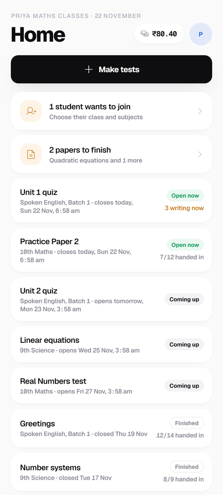
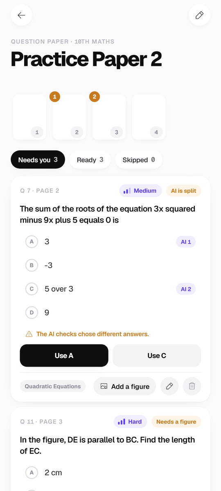
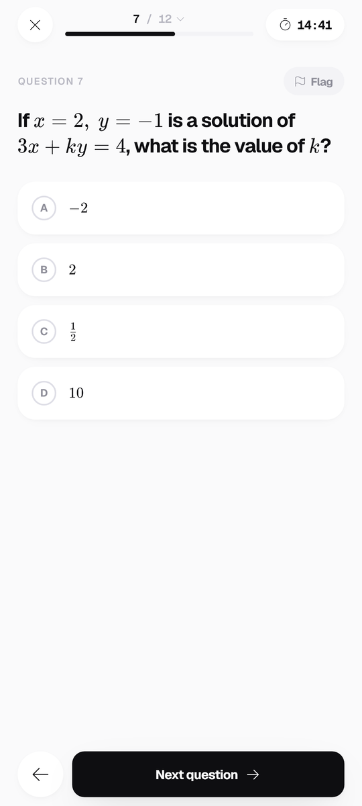
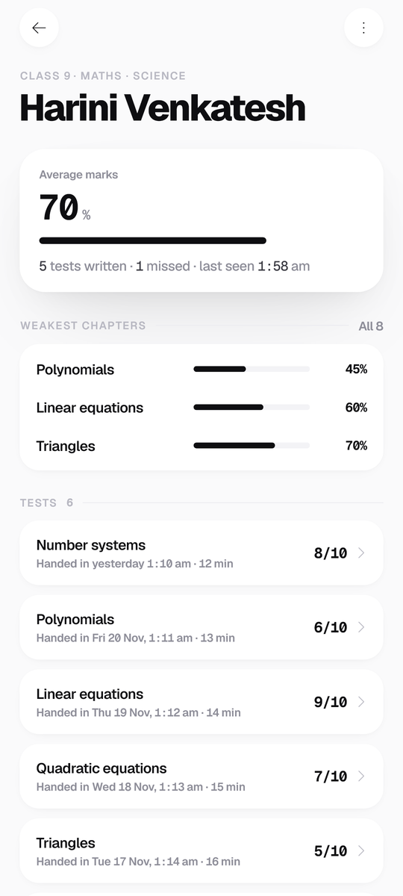

<p align="center"></p>

<h1 align="center">AnyTutor</h1>

<p align="center">
  <b>Photograph a question paper. Hand out the test.</b><br>
  An Android app for tuition teachers. AI reads a question paper into a multiple-choice test, students
  write it on their phones, and every answer is marked the moment they hand in.
</p>

<p align="center">
  <picture><source media="(prefers-color-scheme: dark)" srcset="website/img/tutor-home-dark.png"></picture>
  <picture><source media="(prefers-color-scheme: dark)" srcset="website/img/paper-check-dark.png"></picture>
  <picture><source media="(prefers-color-scheme: dark)" srcset="website/img/student-test-dark.png"></picture>
  <picture><source media="(prefers-color-scheme: dark)" srcset="website/img/student-page-dark.png"></picture>
</p>

<p align="center"><sub>Screens from the app, with sample names. The product's name is not final.</sub></p>

## What it does

**For tutors**

- Add a question paper as photos or a PDF of up to 20 pages, in English, Hindi or Tamil. AI finds
  every question and works out the answers. A printed answer key always comes first; otherwise two
  AI models answer each question and a third settles a tie.
- Only what AI is unsure of waits for the tutor: answers that disagree, a figure it needs, a part
  it could not read. Or describe a test, and AI writes the questions.
- Post it to a group, a course or chosen students, with a time limit, an opening and a closing
  time, and the questions mixed up for each student if you like.
- See each student's average, weakest chapters and missed tests. Fix a wrong answer once and
  everyone is marked again.
- Send parents a report as a picture, with the tuition's name: a month's marks, tests written
  and missed, chapters to practise and the ones going well, and a line from the tutor.
- Print a test as an A4 PDF with the tuition's name at the top, for a written exam: maths, tables,
  figures, Hindi and Tamil as on screen, a case study's passage once above its questions, no
  question split across pages, and the answer key on a page of its own when you ask for it. A
  draft prints from its settings, so a paper for a written exam never has to be posted.
- Ask AI for the worked solutions of a test's questions. AI works each one out without being told
  the answer you marked, and a solution is kept only when it reaches that answer; the questions it
  could not match are named, so you can check their answers. Students see a solution after they
  hand the test in.
- Take attendance for a group or a course: everyone starts as here, and you tap who is away. A
  message for each absent student's parents is ready to send on WhatsApp, and attendance shows on
  the student's page and in the report for parents.
- Keep fees: a monthly fee for each student, payments in cash or UPI with numbered receipts to
  share, who has paid this month and who has not, and a reminder for parents. Only the tuition's
  owner sees fees.
- Every posted test stays in the Bank to post again. A Library shares notes and PDFs. Several tutors
  can share one tuition.
- Invite students with a group's or course's link or QR code. They make their own accounts and ask
  to join; you let them in one at a time, or all at once.
- Prepaid AI credit: ₹2.40 a page read, ₹0.60 a question written, ₹0.40 a worked solution, ₹20
  free to start. Tests, students and marking are free.

**For students**

- Make their own account with a username and password, or with Google. The app keeps no email
  address or phone number.
- Join a tutor's group or course by scanning its QR code or opening its link.
- One question at a time. If the internet drops, the answers stay on the phone until it is back.
- Marks and the right answers the moment they hand in.
- Their attendance, and their fees: pay by UPI from the app, straight to the tutor, then tell the
  tutor it is paid.

**For the developer:** an admin app with the clients, their AI credit and payment requests, the
phones and app versions in use, and how the server is doing.

## How it is built

| | |
|---|---|
| `app/` | Flutter, for Android and for browsers (see "The web version"). Tutors and students use the same app. |
| `admin/` | Flutter, Android. The developer's console. |
| `api/` | TypeScript and Hono on Neon Functions, with Postgres and object storage on Neon. |
| AI | Google Gemini reads the pages; Groq's gpt-oss models, with a Gemini checker, work out the answers. |
| `website/` | Static pages for GitHub Pages, with no scripts. |
| `tools/` | Migrations, sample data, the check suites and the release scripts. |

## Run it on your PC

You need Node 24, Flutter 3.47, Docker, and JDK 17 for Android builds.

```bash
npm install
node tools/local-stack.mjs up     # a throwaway Postgres and S3 store in Docker
npm run migrate
npm run seed
node tools/dev-serve.mjs          # the API at http://127.0.0.1:18787
```

Then `flutter run` in `app/` on the Android emulator: a debug build finds that API by itself. The
guide below covers phones, the checks, deploying and releasing.

## Status

Not released yet. Android 7 and newer; no iPhone app. The name is a stand-in until the product
has its own.

## License

[MIT](LICENSE)

---

# The full guide

## What's here

| Folder | What it is |
|---|---|
| `app/` | The Flutter app (Android). Students and the teacher use the same app. |
| `admin/` | The developer's admin app (Android), "<name> Admin": the clients and their AI credit, who uses the app on which phones, and how the server is doing. |
| `api/` | The API: Hono on Neon Functions, with Postgres and object storage on Neon. The schema and the marking functions are in `api/migrations/`. |
| `design/` | Soft Structuralism comps (`design/comps/`), their screenshots and the token CSS. |
| `tools/` | Scripts to migrate, seed, test, audit, and drive the test phone. |

## How marking stays fair

- The right answers never leave the server until a student has submitted that test.
- Each student gets their own order of questions and options, unless the tutor picks the same
  order for everyone.
- The deadline is the start time plus the time limit, capped at the test's closing time. The
  server enforces it with 30 seconds of grace, and an attempt that runs out submits itself.
- One attempt per test, unless the teacher allows a retake.
- Five wrong passwords lock a login for five minutes.
- While a student is logged in, release builds block screenshots and screen recording
  (Android's FLAG_SECURE). The teacher's screens can still be captured.

## When students see their marks

The moment a student hands a test in, or the time runs out and the app hands it in for them, they
see their marks and every right answer. Nothing waits for the closing time and the tutor has
nothing to switch on. Every test still has a closing time: a tutor who posts one without gets the
next 9 pm India time that is at least three hours away, and one who picks a time already past is
told so. The right answers stay on the server until that student has submitted that test.

Until 1.7.0 marks were held back until the test closed, everyone had finished, or the tutor
showed them early (`tests.results_released_at`, migration 011). That is gone: the column stays in
the database, unused, and the server no longer has the "release marks" route. Replies still carry
`results_open: true` because the apps of 1.4.0 to 1.6.0 read it, and an old app therefore shows the
marks at once too, with no update.

## The tutor app

There are three tabs: Home, Courses and Groups. Home lists every group that has something running:
its live tests (open to students now) and posted tests (published, opening later), with how many
students have submitted and how many are writing at this moment. Groups with nothing running are
listed underneath in one short list. Groups lists them all. Once a course exists, Home has two
sections, Groups and Courses, built the same way; with no courses it is as described. Courses lists
the tuition's courses (see Courses below).

A group (a class and a subject, "10th Maths") has one page: a Make a test button, its tests
(live, posted, drafts, finished) and its students with an Invite students button (see "Join
links"). Class and subject come from the group, so nothing asks for them again. Make a test offers
upload or describe it to AI. The app has no page of questions: a wrong answer is fixed from the
test's own page, which marks everyone's attempt again.

A test's page leads with how it went and who has written it, then the questions (folded to two
with a link to show the rest) and its settings (time limit, opens, closes, order). Settings (the avatar on Home) holds
the tuition's name, the tutors, the subjects, the theme and the password. Several tutors can
share one tuition: they all see every group and test, and any tutor can add another or turn one off
(not themselves) in Settings.

## Tuitions

A tuition is a tutor's business: its own students, groups, subjects, papers, questions and tests.
A person (tutor or student) has one login and belongs to tuitions through memberships, so a tutor
can run a tuition of their own and a student can learn from more than one tutor. Nothing in one
tuition can be read or changed from another: every tutor route reads and writes only the tuition
the request is for, and `tools/tenant-test.ts` checks that by trying every route with another
tuition's ids.

- **Which tuition a request is for.** The app sends the one it is showing in the `x-tuition` header.
  Without it the server uses the person's first tuition, which is how the apps from before tuitions
  keep working. A person who names a tuition they are not an active member of gets 403.
- **Tutors sign up** from the login screen (`POST /auth/signup-tutor`, capped per phone and per hour),
  then create their tuition with the classes and subjects they teach (`POST /auth/tuitions`). The
  first run in the app does both. A tutor can run up to three tuitions.
- **Students make their own accounts** from the login screen: a name, a username and a password of
  8 or more characters (`POST /auth/signup-student`), or Google (see "Google sign-in"). Sign-ups are
  capped per phone and per hour, as a tutor's are. A new student is in no tuition until a tutor lets
  them in. Tutors no longer make students' logins: `POST /teacher/students` and a course's
  `people/new` answer 410 (`students_sign_up`) on every branch but dev, where the seed and the older
  checks still use them (migration 036).
- **Students ask to join** with a group's or course's link (see "Join links"), or with the tuition's
  six-character join code (no 0, O, 1 or I) typed in the app (`POST /student/join`). Either way they
  wait as "pending" until a tutor lets them in from Home (`/teacher/join-requests`). A link already
  says which group or course; with the code, the tutor chooses the class and subjects. Wrong codes
  and links count together, 8 an hour, so neither can be guessed. The owner can close joining, which
  stops the links too, or make a new code.
- **The account is the student's own.** Their class and subjects are per tuition, so one tutor
  regrouping or removing a shared student leaves the student's other tuitions alone. Being turned
  off, being removed or the tuition being deleted never deletes the account or stops it logging in.
  A name belongs to the person: it can be changed only while the student has no other tuition. A
  student changes their own password, or deletes their account, from their profile. No tutor can
  set a student's password, so no tutor can log in as a student (the old
  `/teacher/students/:id/reset-pin` is gone; `tools/security-test.ts` checks it stays gone). The
  app keeps no email, so a student who forgets their password cannot get that account back: they
  make a new account and ask to join again. One who signs in with Google has no password to forget.
  A tutor can still read a student their username from the student's page, and a login locked by
  wrong tries opens by itself after five minutes, or sooner from the developer's app.
- **Subjects.** Standard subjects (Maths, Science, Physics, Chemistry, Biology, English, Hindi, Tamil,
  Social Science, Computer Science) are shared; a tuition picks the ones it teaches and can add
  subjects of its own. Groups are explicit, so a new tutor has theirs before any student exists.
- **AI use is told per tuition** (`ai_usage.tuition_id`), and the evening summary goes to each
  tuition's own tutors.
- **A new database starts with no tuition.** Migration 012 once gave the data that existed before
  tuitions to a first tuition. On a new database that tuition is empty, and migration 032 removes it,
  so every tuition is made by a tutor signing up.
- **The owner can delete the tuition** (see "Deleting a tuition").

## Join links

Every group and every course has a link that a tutor shares to invite students. Invite students, on
the group's or course's page, shows it as a QR code to scan with a phone camera, with Copy link,
Share link, and Share the QR code as a picture: a 1080 × 1350 image with the group's name, the
tuition and the code to type.

- **The link** is `<JOIN_LINK_BASE>/j/<code>`. `JOIN_LINK_BASE` is set on the function; without it
  the link uses the API's own address. The code is 10 characters from the join code's letters,
  shown as `KR7Q4-MPAXZ`, and a student can type it in the app instead.
- **The link opens a page** in the phone's browser that names the tuition and the group or course,
  with Open in the app, and Get the app once `APP_DOWNLOAD_URL` is set. Open in the app is an
  Android intent link to `<app id>://app/join/<code>`, which falls back to `APP_DOWNLOAD_URL` when
  the app is not on the phone. The app keeps the code through sign-up or login and then offers it:
  Ask to join. The page has no scripts, is never cached or indexed and gives away no ids.
  `GET /join/<code>` returns the same summary as JSON.
- **Asking** (`POST /student/join` with the link's code) puts the student in the tutor's join
  requests with what they asked for. Let in adds them to the group (its class, with that subject)
  or to the course. Decline drops the request. Let all in lets everyone in at once and lists anyone
  it could not, with the reason: turned off in this tuition, or in another class there.
- **Make a new link** replaces the old one at once, for a link that reached someone it should not
  have. Closing joining stops the links as well as the join code.

`api/src/routes/links.ts` and `api/src/lib/join-links.ts` hold it; `tools/join-links-test.ts`
checks it.

## Google sign-in

Students and tutors can sign in with Google instead of a password. The app asks Google for an ID
token and sends it to `POST /auth/google`. The server checks Google's signature and that the token
was made for one of its own client ids. It keeps the account's number (`sub`) and the name, and
never the email address. Someone new is asked whether they are a student or a tutor, and gets a
username made from their name. Until `GOOGLE_CLIENT_ID` is set, Google sign-in is off: the app
hides the button and the server answers 403 `google_off`.

To turn it on, in the Google Cloud console (APIs & Services):

1. Set up the OAuth consent screen with the app's name and a support email.
2. Make an OAuth client of type **Web application**. Its client id is the one the app asks Google
   for tokens with.
3. Make an OAuth client of type **Android** for each key the app is signed with: the package name
   (`com.anytutor.app`, or `com.anytutor.app.dev` for debug builds and dev copies) and the
   key's SHA-1 (`keytool -list -v -keystore <keystore>`; the debug key is
   `~/.android/debug.keystore`, password `android`). Google uses it to know the app asking is
   yours; the app never names it.
4. Set `GOOGLE_CLIENT_ID` on the function to the Web client id. Several ids, comma separated, are
   all accepted; `GET /auth/config` gives the app the first.

Client ids are not secrets. `tools/google-test.ts` checks the token check with no network.

## Plans

Every tuition is on a plan (`api/src/lib/plans.ts`, `api/src/routes/plans.ts`, migration 040): Free,
Basic or Pro. A plan sets how many students and tutors the tuition can have and how much AI comes
with it; everything else in the app works on every plan. Santosh chose the sizes on 24 November 2026
("Bigger tiers") and that more AI comes only with a bigger plan or the plan's next month ("Upgrade
only").

- **Sizes and prices** are app settings, changed in the admin app (Settings → Plans): Free 20
  students and 1 tutor, with the one-time free credit to start; Basic 100 students, 3 tutors and
  ₹300 of AI a month; Pro 300 students, 10 tutors and ₹900 of AI a month. Migration 040 sets no
  price: a plan is on sale only once it has a price and a UPI id is set (Settings → Prices and
  payment details). One setting says where plans are sold: in the app and the web version, or only
  one of them (the web version sends `x-os: web`).
- **Room.** Letting someone in past the plan's room is refused with 402 `plan_students_full` or
  `plan_tutors_full`, at all seven places that let a student or tutor in or turn one back on
  (`roomFor`, under the tuition's lock, so two at once never take one place twice). Nobody is ever
  turned off; turning someone off always works.
- **AI every month.** On Basic and Pro, the first AI work or look at the credit in each plan month
  tops the credit up to the plan's AI, once (a `plan` line in the credit history). It never lowers
  credit above it, and unused AI does not pile up. When it runs out, AI waits for the next plan
  month or a bigger plan (402 `no_credit`, saying which). AI left when a plan ends stays usable.
- **Buying.** The owner picks a plan and 1, 3, 6 or 12 months (the price times the months), pays by
  UPI with the tuition's code in the note, and taps "I have paid" (`POST /teacher/plan/requests`; at
  most 3 wait at once). The developer marks it received (the plan starts that day, or runs on after
  the same plan's last day) or declines it (`/admin/plans/requests/:id/receive`, `/decline`), and can
  give or end a plan by hand (`/admin/clients/:id/plan`). A bigger plan starts the day it is
  received; a smaller one is refused while a bigger one runs unless the developer says to replace it.
- **Ending.** A plan past its last day counts as Free. Everyone stays and nothing is deleted; only
  letting more people in than Free allows waits. Received plan payments stay on record with the
  tuition's name if the tuition is deleted.

`tools/plans-test.ts` checks all of it against the local stack, with every AI call scripted.

## AI credit

AI work is paid for in advance, from each tuition's credit, which the tuition's plan fills (see
"Plans"). Amounts are kept in paise (`api/src/lib/credit.ts`, migration 033).

- **Prices.** AI reading a page costs ₹2.40, AI writing a question ₹0.60 and a worked solution ₹0.40
  (migration 037), and a new tuition starts with ₹20. The developer changes all four in the admin app
  (Settings → AI credit), and
  tutors see a new price at once. Turning off "New clients can use AI" gives new tuitions no free
  credit; they can still buy a plan.
- **Only finished work is charged.** Before AI starts, the price of the whole job is set aside. A
  page is charged in the same transaction that saves its questions (once for each picture of it),
  questions when they are written, a worked solution when it is kept, and whatever did not finish
  is let go. Two jobs at once never
  spend the same rupees. When the credit runs out, AI stops and the app says why.
- **No credit on its own.** Since plans, a tutor cannot buy credit by itself: `POST
  /teacher/credit/requests` is refused with 409 `plans_only`, and `GET /teacher/credit` says
  `topups: false`. The code for it stays (`askForCredit`, `TOP_UPS`), so it can come back. Requests
  from before plans can still be marked received or declined (`/admin/credit/requests/:id/receive`
  or `/decline`). The developer can add credit by hand, up to ₹1,00,000 at a time
  (`POST /admin/clients/:id/credit`).
- **What the tutor sees:** the balance on Home, the price before every AI job, a note when credit
  is short, and what the credit was spent on (`GET /teacher/credit`, `/teacher/credit/history`).

`tools/credit-test.ts` checks all of it against the local stack, with every AI call scripted.

## Deleting a tuition

The owner deletes the tuition from Settings, with their password (`POST /teacher/tuition/delete`;
a wrong password counts as a wrong try, as at login). In one transaction everything of the tuition
goes, its tests first so their questions can follow, and so do the accounts of its tutors who are in
no other tuition; their old logins stop working. Students keep their accounts, which are their own:
a student loses this tuition and what they wrote there, keeps any other tuition and its results,
and can join another. AI credit payments stay on record with the tuition's name (migration
034 keeps the top-ups and the credit added by hand; migration 035 tidies the ledger the same way
for any other delete of a tuition, such as a check's clean-up or one run by hand), and the tuition's
files are removed from storage afterwards. Unused credit is lost, and so is the rest of a running
plan; the screen says both before the owner confirms. While one of the tuition's plan payments is
still waiting to be checked, the delete is refused (409 `plan_payment_waiting`): the payment would
go with the tuition and leave the developer with money that matches nothing. Once it is received
(it then stays on record with the tuition's name) or declined, the tuition can go.
Its registers and fee records (see "Attendance" and "Fees") are the tuition's own and go with it.

`tools/delete-test.ts` checks it against the local stack.

A student deletes their own account from their profile (`POST /auth/delete-account`), with their
password, or by choosing their Google account again if they sign in with Google. Everything of
theirs goes with it, in every tuition, except the fee payments their tutors recorded: those stay in
each tuition's records under the student's name (see "Fees"). Google Play asks apps with accounts to
offer this. Tutors who
do not own a tuition cannot delete their own accounts yet.

## Groups and subjects

The tuition teaches more than one subject. Each student studies one or more subjects, and a
group is a class and a subject together: "10th Science" is every Class 10 student who studies
Science. Chapters, questions, papers and tests each belong to a subject, and a test goes to
its group or to chosen students in it. A test never leaves its group: an older "whole class"
test also reaches only the class's students who take its subject. Maths and Science are built
in, and more subjects can be added in Settings or straight from a paper's subject choice.
Students added by the 1.0.0 app, and everything made before subjects existed, count as Maths.

## Courses

A course is the other kind of group: it is not worked out from a class and a subject. A tutor makes
one, names it, and puts in the people they choose, from any class or with no class at all. A person
can be in any number of groups and any number of courses; adding someone to a course never takes
them out of a group, and a person made through a course (a student with no class, no subjects) is in
no group. A course page works like a group page: Make a test, its tests (live, posted, drafts,
finished) and its people, with a page for each person. Every tutor of the tuition sees every course.
A course can be renamed from its own page (Rename course, `PATCH /teacher/courses/:id`, trimmed,
up to 60 characters, 409 when another course of the tuition has the name); its tests, people and
results are not touched, since they hang on the course's id and not on its name. Apps before 1.7.0
have no Rename button.

Everything that belongs to a course (tests, papers, questions) says so in `course_id` and has no
class or subject (migration 019), and no group query returns it, so nothing in a course ever shows
in a group or the other way round. A student sees a Courses list only while they are in at least one
course; a student who is only in courses has no class and opens straight on it. Deleting a course
deletes its tests, questions, papers and results, and never its people: it refuses with 409
`has_attempts` while someone has written a test in it, unless the call says `?with_results=1`.

Old apps cannot show any of this. An app that does not say it is 1.6.0 or newer in `X-App` is never
sent a course or a person with no class, and a student with no class who signs in from one is told
to update (426 `update_required`). The server refuses every main-app build below
`app_settings.min_app_build` the same way, and a new app answers a 426 with a full-screen "Please
update" page. That row does not exist until someone writes it (`tools/min-build.ts`), so releasing
the app forces nothing by itself. The admin app, signing out, and a caller that sends no `X-App`
are never held to it.

## Fixing and deleting

Correcting a question's right option, or its marks, marks again every test already written
with it, so a student who chose the right answer gets the mark even when the key was wrong at
the time. Questions, tests and papers can all be deleted, and students removed from the tuition. A
question leaves the tests nobody has written; one in a test students have written stays, so their
results stay whole. A written test goes only after a second warning, and takes those results with
it. Removing a student takes their results in this tuition with them, and leaves their account,
which is their own; turning them off instead keeps the results.
Deleting a paper also deletes the questions saved from it that no test uses.

## Ready-made questions

`api/src/ready-made/` holds original chapter-wise MCQs, with worked solutions, written for the
NCERT 2026-27 books (nothing is copied from a paper or a book): ten per chapter for Class 7
Maths (Ganita Prakash, 15 chapters), Class 8 Maths (Ganita Prakash, 14), Class 9 Maths
(Ganita Manjari, 14) and Science (Exploration, 13), and Class 10 Maths (14) and Science (13).
That is 830 questions. `node tools/check-library.ts` proves the answer of each of the 441 whose
answer is a number worked out by code. For the 389 whose answer is text (a fact or a statement), it
checks only that the options are sound, so those answers rest on review. It also lists likely
repeats to read.

Since 24 November 2026 every tuition can add them (they were hidden on 9 October 2026 in the
original app, at its tutor's request). The test editor's question picker, for a group whose class
and subject have a book, offers it while the tuition has none of its questions: "Add 140
questions". A tutor gets there from Make tests: under "No paper? Let AI write a test", "Or choose
questions you have" opens a new test for that group or course in the test editor (`/t/tests/new`,
with the class chosen), and Make tests closes once the test is saved. `POST /teacher/ready-made` (`api/src/routes/ready-made.ts`, `api/src/lib/ready-made.ts`)
copies the book's chapters and questions into the tuition as its own questions, marked
Ready-made in the picker, so a tutor can change or delete them like any other. The book is found
by the subject's name: Maths (or Mathematics) and Science. A chapter the tuition already has with
the same name is used as it is. Adding again adds only the questions the tuition no longer has,
and never changes one the tutor changed: each copy's `library_key` holds the tuition's id. It
uses no AI and costs nothing on any plan, and asking AI for the worked solutions of these
questions charges nothing, since each has one. No draft chapter tests are made.
`node tools/ready-made-test.ts` checks it.

`node tools/seed-library.ts` is the older import, kept from the original app: it fills only the
first tuition (made by migration 012) and makes a draft chapter test per chapter. The startup
does not need it.

## Question papers

The teacher adds the pages first: photos, gallery images or a PDF. AI then works out the
paper's name, class, subject, where it comes from (its category, such as "NCERT Exemplar")
and, for a one-chapter paper, the chapter. It asks the teacher only for what it could not
find. Every page is read into drafts, together with any answer key the paper prints, on
whichever page it is.

Answers come from that key first. For the rest, models of two different families each work the
question out on their own, without seeing each other's answer, and each lists every option it
finds correct, not just one (`solve` in `api/src/routes/papers.ts`). A model made to pick one
answer picks one for a faulty question as confidently as for a sound one; asked for the whole
list, it shows a question with two right options, or none. The solver is gpt-oss-120b on Groq
(`GROQ_SOLVE_MODELS`; gpt-oss-20b stands in when the 120b has used its day's allowance) and the
checker is Gemini 3.1 Flash-Lite (`GROQ_CHECK_MODELS`; Gemini 3.5 Flash-Lite, then Qwen, stand in
when it is busy or over its free limit).

`verdict` in `api/src/lib/votes.ts` says what their answers add up to (`node tools/votes-test.ts`).
An answer is marked only when at least two models were heard, each found exactly one right option
and was at least 80% sure, they all chose the same one, and the models that chose it come from at
least two families (gpt-oss, Gemini and Qwen are three: two gpt-oss models that agree prove little,
because they make the same mistakes). A model that found two right options, none, or hesitated
blocks the mark, because the question is at fault. A question the first two split on, or that only
one of them could be heard on, keeps what was said and waits for a stronger Gemini model
(`GROQ_TIEBREAK_MODELS`, the second opinion: a step of its own that runs once the tutor already has
the paper) and is marked when two of the three agree. When one check cannot be reached, the other's
answer is kept, not thrown away. When neither can (both down, twice), the question says "Not checked
yet" and starts again from scratch three minutes later: by itself while the paper stays open on the
tutor's screen (up to five times), and whenever the paper is opened. Questions that need a figure
are left to the teacher.

Why these models: 165 questions an AI had written (140 sound, 25 faulty, each judged by hand) went
through the candidates. gpt-oss-120b was right on 32 of 33 sound questions outside Hindi and Tamil
and on 8 of 12 in them. Gemini Flash-Lite was right on 138 of 140, Hindi and Tamil included, but let
12 of the 25 faulty ones through. The two together blocked 24 of the 25 faulty questions and marked
none of the sound ones wrongly (87% of the sound ones were marked; the rest went to the writer or
the tutor), where two gpt-oss models together blocked 16 and let 6 to 9 through. Gemini Flash-Lite
answers one call in three with "high demand", or takes 30 to 60 seconds, from the evening on; the
check that is down then costs the question a later look, never a wrong answer. On 27 October six
papers of 15 questions (trigonometry, motion and force, English grammar, Hindi grammar, Tamil
grammar, Indian geography and the Constitution) went through the real pipeline on the dev copy
(`tools/out/ai-maker-run.mjs`, not in git): 80 of the 90 were marked before any replacing (all 45 in
maths, science and English; 11 of 15 in Hindi and in Tamil; 13 of 15 in geography) and all 90 after
14 replacements, in 50 to 350 seconds a paper. A hand check of the 90 marks found none wrong and
four that a teacher could argue over (grammar and geography points). The scripted test
`tools/answers-test.ts` (58 checks, no AI keys needed) makes each failure happen on cue: a model that
is down, slow, or answers with junk, two that split, the writer disagreeing, the second opinion, and
whether a flagged question needs its figure (including the solver being refused while it is asked).

Each marked answer says where it came from, so the teacher can check it before saving. Once every question is saved or skipped, the app asks whether to
publish the paper as a test for its class and subject straight away; the test remembers the
paper it came from.

A card also says what AI noticed: part of the question could not be read on the page (some
PDFs print every subscript as a box, ■), or neither model found an option that fits, which
usually means a misprint. AI keeps a ■ where nothing in the question forces what it stood for
(one box is one character, so "t■■■" was three, such as "n+1"), and fills in the ones that are
forced. It does not answer a question it had to fill in or leave a box in: an answer built on a
guess would be a guess. The teacher checks the question and taps "Looks right, find the answer"
(or rewords it), and then AI looks for the answer. A question that repeats an earlier one of the same paper (a
PDF holding its pages twice) is skipped, and saving leaves out any question the bank already
has. Skipped questions can be brought back.

A figure printed with a question is cut out of its page on the tutor's phone. The reader says
whether the question needs it by asking whether a student who sees only the typed words could still
answer: it needs it when the answer depends on something only the figure shows (a point, angle or
label the words never define, values read off a graph, which picture is right), even when that figure
is missing from the page, as in a PDF that lost its pictures. A question that says "in the figure"
but gives everything in words does not need it, so AI answers it like any other; its figure is still
cut and shown when one is found, but the question never waits for it. AI never answers a question
that needs its figure (it cannot see the figure): the tutor marks those. A table printed with a
question is copied into its text (a heading row, a line of dashes, then a row a line, cells between |
marks), and the app sets it as a table; a grid printed without headings is set without a blank
heading row. A figure, circuit or graph is never written as a table. A passage or case study printed
once for a group of questions is copied into each of them, so each can be answered on its own; a
passage printed on the page before its questions is not seen by the page-by-page reader, so those
questions need the tutor's "Fix it".

AI's box for a figure only points at it, because that box is often loose (it takes in an option
line), now and then cut short, and sometimes written with x and y swapped. The phone finds the
figure by edge detection: it marks where the page's grey changes sharply (Sobel), groups the marked
pixels that touch, and takes a big group, or a few close together, with the lines and labels right
beside it as a figure. Text is rows of small groups and stays out. The figure that AI's box overlaps
most is cut, with a little room round it that stops short of anything printed nearby, together with
every other part of it inside AI's box (stages drawn side by side, a triangle set a little apart). A
group big on the page that mostly lies outside AI's box (the shadow on a photographed sheet, a
drawing run into the page's heading) is passed over, and a photo pasted on the page, which edge
detection sees as one block, is cut at AI's box within it. When AI's box points at nothing, the
question's own box is tried; when nothing there looks like a figure either, AI's box is cut as it is
for a question that needs its figure.

The tutor can always put it right by hand. "Cut again" opens the page with the box, which she drags,
pinches to zoom, turns a quarter turn for a sideways photo, or takes to another page of the paper. A
photo, taken or from the gallery, opens on the same screen to be cut down to the figure. "No figure
needed" lets a question AI flagged go on without one, and any question can be given a figure ("Add a
figure"). The code is `app/lib/features/teacher/figure_finder.dart`, tested in
`app/test/figure_finder_test.dart` on made-up pages, and checked on 98 real pages from 36 papers
(`tools/out/fig-bench`, not in git).

Pages are read by Google's Gemini 3.5 Flash-Lite on its free tier (`GEMINI_API_KEY`), about 4
seconds a page. Groq's vision model reads instead whenever Gemini is busy or refuses a page,
and Groq always works out the answers. Without a Gemini key, Groq reads too. Groq limits each
account, not each key, so keys made in one account share one budget: about 1,000 requests a
day per model, and 7,000 input tokens a minute for the vision model, which is only two or
three pages a minute. The app waits out a limit on its own and shows how long it is waiting.
Using several Groq accounts to get past the limits is against Groq's rules.

Gemini's free plan limits each model separately (measured 2026-10-06 from its error replies):
3.5 Flash-Lite 15 requests a minute, 3.5 Flash 20 requests a day, 3.6 Flash 5 requests a
minute; the newest models often answer "high demand" instead. That is why the app reads four
pages at a time (a dozen pages is 13 calls, inside the 15 a minute) and checks answers with
3.1 Flash-Lite.

The app runs the work side by side. Pages are read four at a time, and as soon as the first
page is read, three workers start looking for answers, each taking its own batch of questions
(the server hands every call a different batch: `answer_claimed_at`), while the later pages are
still being read. A printed answer key on a late page replaces any answer AI worked out in the
meantime. A 12-page worksheet took 2 minutes 45 seconds one step at a time and takes about 30
seconds this way (`tools/out/try-parallel.mjs` replays the app's run against the local API).

A paper's pages can also be read together, up to four pages in one Gemini request, instead of one request
a page (`readWithWhole` in `api/src/routes/papers.ts`, the pure parts in `api/src/lib/wholepaper.ts`). It is
switched off: measured on 2026-11-14 it read as well as page by page but took nearly twice as long on papers
of a few pages, so it only helps when Gemini's per-minute limit is the trouble. To try it, set the
`app_settings` key `whole_paper_read` to `true`, or start the server with `WHOLE_PAPER_READ=on` (`off` forces
it off). A page it cannot read, or a request Gemini refuses, is read on its own the usual way.

## Describing a test to AI

In a group, Make a test, Describe it to AI takes a few words ("easy and medium questions on
quadratic equations, with two word problems") and how many questions: any number up to a
thousand, where the top only guards against a slip of the finger. The server asks Gemini 3.1
Flash-Lite, with gpt-oss-120b behind it (`GROQ_WRITE_MODELS`), for the questions as JSON: four
options each and the writer's answer. The result opens in the same review screen as an uploaded
paper. The writer's answer is only a proposal, and the checking models never see it. A question is
marked when two models of different families agree (see Question papers), and the writer's answer
is one more opinion: a mark that differs from it is kept but asks the tutor to check, and a
question whose writer's answer could not be matched to one of its options is never marked. On a
paper AI wrote, a split between the first two models is final, since a new question costs less than
a stronger model's time: the question is replaced (below).

The writer is told to work each answer out in a `work` line before it writes the options, to build
the three wrong options from plausible mistakes, to give every number a calculation needs, never to
write two options of the same value, and to ask only what a textbook settles with one accepted
answer. Each writer model is tried on its own, so one that replies with nothing usable is followed
by the next. By hand, 25 of 165 questions from the first prompt were faulty (15%) and 6 of 90 from
this one (7%), on topics of the same kind (the 6 were a tense question with two acceptable answers,
a loosely worded constitution question, a question whose options showed raw maths markup, a badly
worded rolled-paper problem and two Tamil grammar questions).

One reply holds about 25 questions, so the app asks for twenty at a time. The first call makes
the paper. Each later call sends its `paper_id`, is told which questions are already written and
adds new ones, so a test can be any length: 47 questions took three calls and 19 seconds, with
no repeats. The app shows how far it has got and waits out the free tier's per-minute limit. If
the allowance runs out part way, it keeps what was written and says how many.

A question the checks cannot settle is replaced, not handed to the tutor. After the answers and the
second opinions, the app asks the server to replace each question of the paper that has no answer,
or an answer other than the one the writer meant (`POST /teacher/papers/:id/replace`). The question
is left out (it shows under Skipped as Replaced, with the reason, and can be brought back), and the
writer is asked for a new one on the same request, which takes its number and goes through the same
checks. What is still unsettled after that is replaced again, up to three rounds in one run; the
paper keeps trying when it is opened again. A question the models could not be reached for is not
replaced: it is asked again (see Question papers). A question the tutor has marked, reworded or brought
back is hers and is never replaced, and neither is anything in an uploaded paper. The server keeps
the request the paper was written from (`papers.ai_request`, migration 021), says whether more can
be replaced in `replaceable` on `GET /teacher/papers/:id`, and stops at 20 replacements or the
paper's length, whichever is larger. An app that finds no `replaceable` leaves the paper alone. A
question is replaced one for one, so the paper keeps its size (a server test checks it, and a run on
the dev copy that asked for 10 questions and made 2 of them unanswerable ended with 10, 2 replaced),
and when the replacing is over the review says how many were replaced and how many questions the
paper still has, because the replaced ones stay listed under Skipped.

Measured earlier on 27 October on the dev copy with the real models and the first version of the
checks (`tools/out/ai-maker-run.mjs`, not in git), three papers of 20 questions each, on linear equations, on ratio and profit and loss word problems, and
on number systems: 17, 18 and 19 questions were clean after the checks, and all three papers ended
with 20 of 20 clean, after 4, 4 and 1 replacements, in 39, 47 and 27 seconds. The second paper
used all three rounds.

Models write LaTeX in JSON with one backslash (`\frac`), which JSON reads as a form feed plus
"rac". Every model reply passes through `fixLatexEscapes` first (`api/src/lib/latex-json.ts`,
checked by `node tools/latex-json-test.mjs`), and an option that is all maths but came without
`$...$` gets them.

## Worked solutions

A test's results, and a draft's settings, show how many of its questions have a worked solution, and
offer to write the rest with AI at the price shown (`app/lib/features/teacher/worked_solutions.dart`).
After a card that says what it costs, the app sends the questions four at a time
(`POST /teacher/tests/:id/solutions`, `api/src/routes/solutions.ts`); one AI call answers the four.
A draft is saved first, so its questions are the test's.

- **AI is never told the answer marked.** The model (Gemini 3.1 Flash-Lite when its key is set, then
  gpt-oss-120b and gpt-oss-20b; `GROQ_SOLUTION_MODELS`) works each question out, writes the working
  in the question's language with maths in LaTeX, and says which option it reached. The solution is
  kept only when that is the option marked. One that reaches another option, needs a figure AI
  cannot see, or names an option by its letter is not kept and costs nothing: students see the
  options in an order of their own, so "option B" would be wrong on most screens. The app names the
  questions AI could not match, with the letter it reached and the one marked, so a wrong answer
  key shows itself.
- **Never replaced.** A question that has a solution, the tutor's or AI's, is left as it is. The
  save takes a question only while it has none, in the transaction that charges for it, so a
  solution typed meanwhile stays and a repeated request is not charged twice.
- **Whose it is.** `questions.solution_by_ai` marks a solution AI wrote, and the question editor
  says so. The tutor changing it makes it theirs. Changing a question's answer removes a solution
  that is still AI's, since it reached the old answer; the editor says so before saving.
- **Students** see a solution in their review after they hand the test in, as before; nothing is
  sent while they write it.

`node tools/solutions-test.mjs` checks the prompt and how a reply is read, offline;
`node tools/solutions-test.ts` checks the route end to end against the local stack, with the model
scripted. Neither has seen a real model's solutions: the server here has no AI keys.

## Attendance

A tutor takes a class's register for a day: everyone starts as here, the tutor taps who is away and
saves (`app/lib/features/teacher/attendance_screens.dart`, `api/src/routes/attendance.ts`, migration
038). A class is a group (a class level and a subject, the way tests name one) or a course.

- **One register per class per day.** Two tutors taking the same class's register for the same day
  update the same one (`PUT /teacher/attendance` saves with `on conflict`). A day that has not come
  is refused, and so is one more than a year ago. Each student on a register has a row of their
  own, so it still says who was there after a student changes class or leaves.
- **Where it shows.** A group's and a course's page say how today stands, and a month of registers
  is one page (`GET /teacher/attendance/month`). A student's page and the report for parents give
  the student's attendance; the student's Home shows this month's once a register has been taken.
- **Telling parents.** Once a register is saved, a message is ready for each student marked away,
  sent through the share sheet (WhatsApp or anything else). The app keeps no phone numbers.
- **What goes with what.** Removing a student from the tuition takes their marks, as it takes their
  results. Deleting a course, a subject or the tuition takes its registers.

`node tools/attendance-test.mjs` checks the rules offline; `node tools/attendance-test.ts` checks the
routes end to end against the local stack and needs migration 038.

## Timetable

A class's times and the link to join it online (`api/src/routes/timetable.ts`, `api/src/lib/timetable.ts`, migration 041). A class is a
group or a course, as for registers. Any tutor of the tuition keeps it, from the Timetable button on the class's page.

- **A time** is a set of weekdays (Monday 1 to Sunday 7) at one time of day in India, for 10 minutes to 6 hours, with an optional
  link and a note of up to 80 characters. A class has up to 10 times (409 `too_many_times`, checked under the class's lock).
- **The link** is the tutor's own Google Meet, Zoom, Jitsi or other online class: the app has no video of its own. The server takes
  only a plain https link with a website and no login in it, up to 500 characters, and refuses anything else (400) rather than
  cleaning it up; the app checks again before it opens one, and names the website on the button. On a phone it opens in the Meet,
  Zoom or Jitsi app when one is installed, else the browser (`Links.kt`); in the web version, in a new tab cut off from the app, or
  in the same tab when the browser blocks new ones.
- **Students** see today's classes on their Home, earliest first, with Join on those that have a link; on a day with none, the
  next class. "Today" is India's calendar on the server's clock, never the phone's. A student sees the times of the groups of their
  class whose subject they take and of their courses, and none while their place is turned off.
- A time belongs to the group's or course's own row: removing a group or deleting a course takes its times, and renaming a subject
  keeps them.

`tools/timetable-test.ts` checks it against the local stack.

## Fees

Only the tuition's owner sees fees (`app/lib/features/teacher/fees_screens.dart`,
`api/src/routes/fees.ts`, `api/src/lib/fees.ts`, migration 039). A helper tutor is refused them and
sees none on Home or on a student's page. Money is whole paise throughout.

- **The fee.** A monthly fee for chosen students, a group or a course, from this month or the next,
  due on a day from 1 to 28 (`fee_rates`, a row per student per month it starts). Setting a fee
  replaces any change planned after it; ₹0 stops it.
- **The month at a glance.** `GET /teacher/fees?month=` gives the totals (expected, collected,
  waiting to be confirmed, left, late), each student's state, payments to confirm, payments for
  students no longer in the tuition, and students with no fee. A student's own page lists their
  months and payments, with "Remind the parents": a message with the months owed, the amount and
  the UPI id, through the share sheet.
- **Payments and receipts.** A payment is recorded in cash, UPI or other, for one month, with the
  day it was paid and an optional note such as a UPI reference. Each takes the tuition's next
  receipt number (`tuitions.fee_receipt_no`), so no number is given twice, even after a payment is
  taken away. The receipt is shared as a picture with the tuition's name, light whatever the
  phone's theme.
- **Paying by UPI from the student's app.** The owner adds a UPI id and the name it shows
  (`PUT /teacher/fees/upi`). The student's Fees screen then shows a UPI QR code for the oldest
  month owed, a button that opens a UPI app on the phone with the amount and a note filled in
  (`upi://pay`, `app/lib/core/upi.dart` and `Upi.kt`), and "Send the details to a parent". The app
  cannot see a payment, so it never says one went through: the student taps "I have paid"
  (`POST /student/fees/paid`, with an optional reference), the owner is notified, and it waits on
  their Fees screen to confirm or mark not received. Recording a payment for that student and month
  settles it. The money goes from the payer's bank to the tutor's; the app never holds it or takes
  a share.
- **Records last.** A student removed from the tuition keeps their payments, shown under "No longer
  here"; a student who deletes their account leaves their payments under their name.
- **Limits.** A fee of up to ₹1,00,000 a month and a payment of up to ₹10,00,000, for a month from
  two years back to next month.

`node tools/fees-test.mjs` checks the rules offline; `node tools/fees-test.ts` checks the routes end
to end against the local stack and needs migration 039. No real UPI payment has been made from the
app yet.

## Hindi, Tamil and other languages

The screens are English; the questions are in whatever language the tutor works in. A paper
printed in Hindi or Tamil is read, its answer key matched ((क)(ख)(ग)(घ), (अ)(ब)(स)(द), (அ)(ஆ)(இ)(ஈ),
Hindi and Tamil digits), and its answers worked out like an English one, and a test described in
Hindi or Tamil, or with "in Tamil" in the request, is written in that language. The prompts say so,
and three things that would have broken on non-English text are fixed (`api/src/lib/text.ts`,
checked by `npm run test:text`): the repeat detector kept only a to z and 0 to 9, which made every
Hindi or Tamil question without digits a repeat of the first one and skipped it, the printed
answer was matched by English labels only, and an option that looked like bare maths was wrapped
in `$...$` even when it held Hindi or Tamil words. Usernames are in English letters: a student types
their own at sign-up, and one who signs up with Google under a name in Tamil or Hindi letters gets
one made from "student". (On the dev branch, where a tutor can still make a student's login, AI
spells such a name in English for the username.)

Measured on 16 verified Class 10 Maths questions (plain text), translated to Hindi and Tamil by
Gemini, printed as four-page papers and sent through the real pipeline (`tools/out/lang/`, not in
git): details found on every paper (class 10, Maths, a name), all 16 questions and options read on
every paper, and the printed key matched 16 of 16 in all three languages. Without a key AI marked
16 of 16 right in English, Hindi and Tamil on 27 October, after the answer checks were reworked
(on 10 October it was 16, 15 and 15, the other question left for the tutor), with none wrong. Tamil letters that look alike (ண and ன) were misread once in
four Tamil runs, so a tutor still checks the questions, as with English.

## Screens stay current

Every change made in the app tells the screens showing that data to load again, and a tab
loads again when it comes back into view or the app returns to the front. Home, a test's
results and the student's home also check every 30 to 60 seconds while on screen, and stop
after 15 minutes without a touch, so a phone left open does not keep the database awake.

## Updates

From 1.2.0 on, the app updates itself. When it starts, and when it comes back to the front
(at most every two hours), it reads `update.json` from the latest GitHub release. If that
names a higher build number than the one installed, Home shows "Version 1.2.1 is ready".
Update downloads the APK, checks its SHA-256 against the feed and hands it to Android's
package installer. The first time, Android asks once whether the app may install apps.
After that, Android 12 and later put the update in without the Install prompt; older Android
shows it. Android closes the app while it replaces it, and a notification offers to open the
new version. Settings (and a student's profile) show the version and can check at once.

Versions 1.1.0 and earlier have no updater, so 1.2.0 has to be installed by hand once.
Debug builds never offer an update unless they are built with
`--dart-define=UPDATE_FEED=...`.

## The admin app

`admin/` is a separate Android app for the developer, "<name> Admin" (app id `adminAndroidAppId` in `app/lib/core/brand.dart`).
It takes only a developer login, and reads either the live database or dev. It shows:

- every account, when it was last seen, and who is online now;
- each phone an account is signed in on, with its model, Android version and app version, and
  phones shared by more than one account (apps from 1.2.1 report this; an older app's login
  counts as one phone until it updates);
- the login history, wrong passwords and lockouts;
- which app versions the phones run;
- the database and storage sizes, and an estimate of this month's compute hours, taken from
  when the database woke and its last request (Neon's own usage figures read 0 on the free plan;
  its console has the exact number);
- API requests a day, the slowest routes and server errors, and the AI reader's use;
- the clients: every tuition with its students and tutors, its API requests (today, 30 days, a
  14-day chart) and what its AI use would cost at Google's and Groq's list prices, in rupees
  (`api/src/lib/pricing.ts`, from the tokens each call used). The free plans mean nothing is billed,
  so this is what the work is worth, not a bill. Students are only ever counted there, never named.
  Requests are counted per client from migration 017 on (`api_daily_tuition`).

It changes only a few things: it can sign an account out of one phone, unlock a locked login, and
handle plans and AI credit (mark a plan payment received or declined, give or end a plan by hand,
set each plan's room, AI and price and where plans are sold, add credit by hand, and set the AI
prices and the UPI details tutors pay to; see "Plans" and "AI credit").
Only signed-in requests and logins are counted, since they use the database anyway; the
notification trigger and anonymous traffic never wake it.

It looks the same as the main app because it uses the main app's own theme and components.
`admin/lib/theme.dart`, `ui/tokens.dart`, `ui/kit.dart` and `ui/motion.dart` are copies: change the
originals in `app/lib`, then copy them over again with `node tools/sync-admin-ui.mjs`. The icons come from
`tools/gen-icons.mjs`, which writes both apps' sets.

The developer login is made per branch, with the password typed at a hidden prompt:

```bash
node tools/create-developer.ts --env .env.main --username <name>
```

The admin app updates itself like the main app, but privately: a release goes into the branch's
storage, and only the developer login can download it. The first install is by hand (the APK is
copied to `tools/out`).

```powershell
.\tools\release-admin.ps1 -Notes notes.txt -ApiBase https://<live API address> -Repo <owner>/<public repo>
```

`-Repo` is where the main app is released; with it, the admin app shows those releases and their
download counts.

A release build reads only the API it was built with, the live one; there is nothing to switch.
A test build (`flutter run` in `admin/`) looks for the API on this PC at `http://10.0.2.2:18787`
(the PC as the emulator sees it). On a phone: `adb reverse tcp:18787 tcp:18787`, then
`flutter run --dart-define=API_BASE=http://127.0.0.1:18787`.

## Notifications

Push notifications go through Firebase Cloud Messaging. Each student is told once about each
test, the moment it is open for them: when it is published, or later if they join its group or
are added to it (`test_notices` records who was told). They get a reminder an hour before it
closes if they have not started it
(only for tests that were open two hours or more; for a shorter one, the first notification
already gave the closing time). At 8 pm India time the teacher gets a summary of the day, if
anything happened. For fees, the tuition's owner is told when a student says they paid by UPI, and
the student is told when the tutor records a payment for them, confirms theirs or marks it not
received (`api/src/routes/fees.ts`). Attendance sends no notifications: parents are told through
the share sheet.

The app registers the phone after logging in and on every start. The registration belongs to
that login, so logging out stops the notifications on that phone, and a password change stops them
on every other phone. Android shows a
notification only while the app is in the background. One that arrives with the app open makes
the screens load again instead, so the new test is on the student's home screen at once.
Publishing an open test
announces it straight away. Everything else comes from `/cron/notify`, which a Neon trigger
calls every five minutes. That run reads the time of the next
notification from `notify/next.json` in the bucket and only queries the database when it is
due. If it queried every time, the 0.25 CU compute would never scale to zero: 186
compute-hours a month, and the free plan has 100.

To set it up, once:

1. In the Firebase console, create a project and add two Android apps:
   the app id from `app/lib/core/brand.dart` (`androidAppId`) and the same id with `.dev` on the end. Save the
   `google-services.json` you get after the second as `app/android/app/google-services.json`.
   Builds made without that file work normally, with notifications off.
2. In Project settings, under Service accounts, generate a private key. Save it as
   `api/firebase-service-account.json` and upload it to the function:

   ```powershell
   powershell -ExecutionPolicy Bypass -File tools/upload-firebase-key.ps1 -Branch dev
   ```

3. Create the trigger on that branch. The cron is in UTC; every five minutes lines up with
   India's :00 and :30.

   ```bash
   neon triggers create --branch dev --function-slug api --name notify --cron '*/5 * * * *' --function-path /cron/notify
   ```

Until the key is on a branch, the API there reports `"push": false` at `/` and sends nothing.
The trigger is not declared in `neon.ts`: `neon dev` refuses to run against a branch that is
missing a declared trigger, and `neon deploy` leaves triggers made with the CLI alone.

## Running it

You need Node 24, Flutter 3.47, the Neon CLI (`npm i -g neon`, then `neon login`) and an
Android phone with USB debugging on.

**1. Install and link to the dev branch**

```bash
npm install
neon link --project-id <the startup's project id> --branch dev -y
neon env pull
```

`neon env pull` writes the branch's database and storage settings to `.env.local`.

**2. Database** (first time, or after a schema change)

```bash
npm run migrate
npm run seed
```

The seed adds 8 sample students, 42 sample questions and sample tests. Their logins and the
teacher's go to `tools/out/sample-logins.md`. That folder is git-ignored, so logins never
reach the repo.

**3. The API on your PC**

Put the AI keys in `api/.env.secrets` (git-ignored): the Groq keys as
`GROQ_API_KEYS=key1,key2` and the Gemini key as `GEMINI_API_KEY=key`. Then, in PowerShell:

```powershell
$env:GROQ_API_KEYS = ((Get-Content api\.env.secrets) -match '^GROQ_API_KEYS=')[0].Substring(14)
$env:GEMINI_API_KEY = ((Get-Content api\.env.secrets) -match '^GEMINI_API_KEY=')[0].Substring(15)
neon dev --source ./api/src/index.ts --port 8787
```

`tools/upload-groq-keys.ps1 -Branch dev` puts both keys on a deployed branch.

**4. The app on the phone**

```bash
adb reverse tcp:8787 tcp:8787
cd app
flutter run --dart-define=API_BASE=http://127.0.0.1:8787
```

This is the test build, "<name> Dev" (the app id with `.dev` on the end), so it
installs beside the live app. Leave out `--dart-define` and it looks for the API at
`http://10.0.2.2:18787`, which is this PC as the Android emulator sees it (see below); on a phone,
give the address as above.

**On this PC only, with no cloud account**

The checks that need a database can run against a throwaway one on this PC, in Docker:

```bash
node tools/local-stack.mjs up
npm run migrate
npm run seed
node tools/dev-serve.mjs
```

`local-stack.mjs up` starts Postgres and an S3 file store and writes `.env.local` for them (only
when that file is missing or was written by it, so a real branch's settings are never
overwritten). `dev-serve.mjs` serves the working tree's API at `http://127.0.0.1:18787`, with pushes
in dry run; restart it after changing the API. Run the suites with `--base http://127.0.0.1:18787`.
`node tools/local-stack.mjs down` stops both, and their data goes with them.

Android builds need JDK 17: set `JAVA_HOME` to it before `flutter build apk`.

## Deploying the API

```bash
npm run deploy
```

This deploys the API function on the linked branch. The Groq keys are set on the function
once per branch, outside `neon.ts`, so a deploy never carries them:

```powershell
powershell -ExecutionPolicy Bypass -File tools/upload-groq-keys.ps1 -Branch dev
```

Until that has run on a branch, the API there reports `"ai": false` at `/` and the paper
reader is off.

The live API runs on the `main` branch. Ship an API change or a new migration there too,
once it works on dev:

```bash
node tools/migrate.ts --env .env.main
neon deploy --branch main --no-env-pull
```

Keep `--no-env-pull`: without it, `neon deploy` writes `main`'s settings over `.env.local`,
and the scripts that read it would then point at the live database.

## Checks

| Command | What it proves |
|---|---|
| `npm run typecheck` | The API type-checks. |
| `npm run test:latex` | The LaTeX repair for model replies, the bare-maths wrapping and line breaks written as the two characters `\n` (34 cases). |
| `node tools/tidy-test.mjs` | The clean-ups of a page read's question words (`api/src/lib/tidy.ts`), on texts the reader really wrote: a printed answer key copied into a question comes out (and its labels come off the options), a figure written out as a table goes, and a table copied into a question it is not printed with stays only with its own. |
| `node tools/pieces-test.mjs` | Boxes as models write them, and putting a question that ran over a page edge back together, including the rest of one whose last options the reader wrote into its words. |
| `node tools/second-look-test.mjs` | The second look at questions a page read left without their choices (`api/src/lib/second-look.ts`), on the real misread of a photographed book page: which questions are read again (only on a page that is mostly multiple choice; never a question cut by the page edge, an Assertion and Reason question or an unnumbered one), and what is taken from the new read (a whole list of choices that is not another question's, and words only when they hold all of the old). No keys, no database. |
| `node tools/wholepaper-test.mjs` | The pure parts of reading a paper's pages together (`api/src/lib/wholepaper.ts`): how pages are split into requests, reading a reply that holds several pages, keeping the pages of a reply that was cut off, pages that came back empty or looping, and folding a question's rest on the next page into the question. No keys, no database. |
| `node tools/passages-test.mjs` | Handing a passage on to the questions at the top of the next page (`api/src/lib/passages.ts`), on the two layouts seen in real papers (a case study whose last question starts the next page, and a passage printed alone at the foot of a page with its graph and questions on the next) and on the layouts that must be left alone: a question of its own that merely comes next, a question that follows on by number but speaks of things the passage never mentions (the next case study's, when its own passage was missed), an Assertion and Reason section or key, a section that numbers afresh, a table question, a section heading. No keys, no database. |
| `node tools/tenant-test.ts` | 141 checks that tuitions are walled off from each other (their attendance and fees too), and that sign-up, joining, switching, removals, the owner's join code, the rate limits, picture keys and chapters from another tuition, upload sizes and the daily AI cap behave. It makes its own tutors, tuitions and students, and removes them. |
| `node tools/security-test.ts` | About 1,100 checks that walk every route the API has (all but deleting a tuition, which `delete-test.ts` covers), found from the app itself: nobody and each role are refused what they should be, a tutor of another tuition can read or change nothing, junk bodies, ids and queries never end in a server error or an unanswered request, the answer key never reaches a student, a new password signs the other phones out, guesses sent all at once are counted one by one, the sign-up and tuition caps hold under a burst, and an oversized body is read away and refused. `--only '<regex>'` fuzzes just the routes whose `METHOD /path` matches. It makes its own data and removes it. Dev only. |
| `node tools/load-test.ts` | A classroom (40 students unless `--students` says otherwise) logs in, opens the home screen, starts a test, saves answers and submits, all at the same moment, then reads the marks: no server errors, one finished attempt each, each marked on its own answers, the marks open for everyone, and a table of how long each step took (the trip from your PC to the database is in those figures). It makes its own data and removes it. Dev only. |
| `node tools/levels-test.ts` | 47 checks of classes 1 to 12 and the levels a tuition names itself. |
| `node tools/votes-test.ts` | 55 checks of when AI answers agree enough to mark a question: how a model's reading counts (one option, several, none, hesitant), models of two families, splits, the writer's answer, a split on a paper AI wrote being final, and whose word decides whether a question needs its figure (gpt-oss in the solver's place decides alone, another model only with a checker of another family; a checker that needs the figure still stops a mark). |
| `node tools/answers-test.ts` | 58 checks of the answers and second-opinion steps with scripted models (the API runs in the process against the dev database, every AI call is answered by a script, no keys or quota needed): a model down, slow or answering junk, two that split or doubt, a partial answer kept, the writer's own answer, a question left "not checked yet" and asked again, and whether a flagged question needs its figure: the solver decides, a group shares its figure box, the tutor's word stands, and a question held for the tutor is asked again a few minutes on when the solver was refused. |
| `node tools/plans-test.ts` | 124 checks of plans end to end: the sizes and prices the developer sets, a plan on sale only with a price and a UPI id, where plans are sold, "I have paid" and the developer marking it received or declined, months running on, the room each plan has at all seven places that let people in (two at once never taking one place twice), the AI each plan month tops up once even with two jobs at once, a plan that ends, a bigger plan, a plan given or ended by hand, and a tuition that cannot be deleted while a plan payment waits. The API runs in the process against the local stack, every AI call answered by a script. It makes its own data, removes it, and puts the settings back. Dev only. |
| `node tools/credit-test.ts` | 85 checks of AI credit end to end: the free start, the price set aside before AI work and charged only for what finishes, a page charged once for each picture of it, two jobs at once never spending the same rupees, AI stopping when the credit runs out, credit no longer sold on its own (`plans_only`), and credit from before plans (the developer marking a request received or declined, or adding credit by hand). The API runs in the process against the local stack, every AI call answered by a script. It makes its own data, removes it, and puts the credit settings back. Dev only. |
| `node tools/solutions-test.mjs` | 68 offline checks of worked solutions (`api/src/lib/solutions.ts`): what the model is asked (never the answer marked), how its reply is read, and which solutions are kept: only one that reaches the marked answer, never one that names an option by its letter. |
| `node tools/solutions-test.ts` | 61 checks of worked solutions end to end (`api/src/routes/solutions.ts`): a solution kept and charged only when AI's own working reaches the marked answer, the ones it cannot match named and free, a solution that is there never replaced or charged twice, AI stopping when the credit runs out, another tuition's tests out of reach, a new answer taking away AI's solution, and students seeing it only after they hand the test in. The API runs in the process against the local stack, every AI call answered by a script. Needs migration 037. Dev only. |
| `node tools/attendance-test.mjs` | 34 offline checks of attendance's rules (`api/src/lib/attendance.ts`): India's date, which days a register can be taken for, the month a list of registers covers, who is marked absent, and one student's marks summed up. |
| `node tools/timetable-test.ts` | 64 checks of the timetable end to end: India's weekday on the server's clock, today's classes and the next one, what is refused (days, start, length, links that are not plain https, a class the tuition has no group for, an eleventh time), adding, listing, changing and taking off times by either tutor, the group's and course's pages, who sees which times (another class, a subject not taken, another course, a place turned off, another tuition), and a removed group, a deleted course and a renamed subject. The API runs in the process against the local stack. It makes its own data and removes it. Dev only. |
| `node tools/ready-made-test.ts` | 35 checks of ready-made questions end to end: the six books of 830 questions the server carries, what a group is offered (its book, none for a class without one, a group the tuition does not have), adding a book (every question in its chapter, in the book's order, with the proved answer and its worked solution), the picker listing them, adding again (nothing, or only what was deleted, and a tutor's change kept), a chapter the tuition already had, each tuition's own copy, a subject named Mathematics, worked solutions that charge nothing, and students and the signed-out refused. The API runs in the process against the local stack. It makes its own data and removes it. Dev only. |
| `node tools/attendance-test.ts` | Attendance end to end (`api/src/routes/attendance.ts`): a register for a group or a course, one per class per day (a second tutor updates it), a day that has not come refused, a student not in the class refused, a student who leaves keeping their mark, the group's and course's pages, a student's page, report and own Home, a register taken away, removals, and another tuition reaching none of it. The API runs in the process against the local stack. Needs migration 038. Dev only. |
| `node tools/fees-test.mjs` | 72 offline checks of fees' rules (`api/src/lib/fees.ts`): months and how far back and ahead they go, money in paise and in rupees, the due day, how and when a payment was made, UPI ids, where a month stands, and a student's months worked out from the fees set and the payments made. |
| `node tools/fees-test.ts` | Fees end to end (`api/src/routes/fees.ts`): only the owner sees fees; the UPI id; a fee for a group, a list and from next month, and stopped; receipt numbers never given twice; a student's "I have paid" taken back, confirmed, settled by the tutor recording it, or turned down; a payment taken away; the owner's Home and a student's page and Home; payments kept on record by name when a student is removed or deletes their account; and another tuition reaching none of it. The API runs in the process against the local stack. Needs migration 039. Dev only. |
| `node tools/delete-test.ts` | 42 checks of deleting a tuition: only its owner, only with the owner's password; every row goes; its tutors' accounts go and their logins stop working, while every student keeps theirs (and a tutor with a place elsewhere keeps theirs too); the other tuition is untouched; payments stay on record; storage is emptied. In the process, against the local stack. Dev only. |
| `node tools/join-links-test.ts` | 88 checks of students making their own logins and joining with a link: signing up with a password or with Google, a tutor's links and what they show to anyone, asking to join with one, letting students in one at a time or all at once, or declining, a new link stopping the old one, the account staying the student's own (turned off, removed, a new password, deleting it), group names worded as the app words them, and tutors no longer making students' logins outside dev. Google is played by a key made for the run, so it needs no network. The API runs in the process against the dev database. It makes its own data and removes it. Dev only. |
| `node tools/google-test.ts` | 54 checks of Google sign-in's token check (`api/src/lib/google.ts`) and a join link's code, address and page (`api/src/lib/join-links.ts`), with tokens signed by a key made for the run. No database, no network. |
| `node tools/replace-test.ts` | Checks that the question maker replaces what its checks could not settle and never touches what the tutor has, what waits for a second opinion, what a call is working on, or an uploaded paper. The new questions come from the real writer, so the API needs its AI keys. Dev only. |
| `node tools/courses-test.ts` | 123 checks of courses: people from any class or with no class at all, a course's papers, questions and tests kept out of every group, app versions from before courses kept away from them and told to update, the minimum-build gate, and deleting a course while its people stay. Against the local dry-run API (`--base http://127.0.0.1:8787 --log server.log`) it adds a check that the push names the course. It makes its own data and removes it. Dev only. `tools/courses-demo.ts` sets up a small demo of courses on dev (`--clear` removes it). |
| `node tools/bank-test.ts` | 28 checks of the Bank (`GET /teacher/bank`, app 1.8.1): every paper the tutor has posted once, with how often it was used and the latest test to post it again from. The same questions in another order, fewer of them or for another class are other papers; a draft, a test taken down or a test deleted is no longer a use; who the test went to (the group, or students chosen one by one) is in the row. It makes its own questions and tests through the API, needs no database connection, and removes them again. Dev only. |
| `node tools/v180-extras-test.ts` | 135 checks of what app 1.8.0 adds on the server: the update gate (a test already started can still be finished), a test left open for a week (the list on Home, Close the test, Remind the students, and the tutor's notification), Library files in the tutor's own order and the notice to students, renaming any subject, easy, medium and hard levels on questions and drafts, and storage per tuition for the developer's app. The notifications are only seen against the local dry-run API (`--base http://127.0.0.1:8787 --log server.log`); `--ai` also has the AI write a few questions. It makes its own data and removes it. Dev only. |
| `node tools/text-test.mjs` | Hindi and Tamil text handling, the test writer's answer matching and suggested usernames. |
| `node tools/summary-test.ts --log server.log` | 7 checks that the evening summary goes to each tuition's own tutors (after 8 pm India time; local API, dry-run push). |
| `npm run test:api` | 182 end-to-end checks of the marking rules, when results open (closing time, last student, tutor, and which app versions wait), usernames for students who share a name, subjects (one in use cannot be deleted, one nothing uses can), groups, the home and group pages, tutors, logins, question papers (including ones uploaded before their details are known, printed answer keys that replace AI answers, questions the bank already has, two answer calls at once and question groups) and the admin app's API, against the deployed dev API or the one on this PC (`-- --base http://127.0.0.1:18787`). It logs in with the seed's sample logins, so it never runs against `main`; the admin checks run only where the logins file has a developer login. It creates its own students, subject, tests and paper, gives its tests only to those students, then removes them all. |
| `node tools/notify-test.ts --log server.log` | 25 checks of the notifications against the API on your PC, run with `PUSH_DRY_RUN=1` so each notification is written to the log instead of sent. Dev only. |
| `node tools/check-answers.ts` | Every sample question's marked answer is right, and no other option equals it. |
| `node tools/ai-test.ts` | How accurately the AI reads the 2-page sample paper (render it first with `tools/make-sample-paper.ps1`). |
| `flutter analyze` and `flutter test` (in `app/` and in `admin/`) | The lints and the widget tests; the screenshot harnesses run in their check-only mode. |
| `SHOTS=1 flutter test test/shots/screens_test.dart` (in `app/` or `admin/`) | Draws the screens, light and dark, to `tools/out/shots` on your PC from a stub server: the real widgets and fonts, no phone. `LANDSCAPE=1` in `app/` draws them on their side, and `WIDTH_DP=360 TEXTSCALE=1.5` draws them on a narrow phone with large text, which is how to find what stops fitting. |
| `flutter test test/contract/tenant_flow_test.dart --dart-define=API_BASE=http://127.0.0.1:8787` (in `app/`) | The app's session code against the local API: sign up, make a tuition, join a second one, be let in, switch. Then `node tools/out/cleanup-contract.mjs`. |
| `python tools/audit.py` | The design audit: type scale only, no stray colours, no banned patterns, and where the accent is used. |

On a fresh database, run `node tools/test-accounts.ts --base http://127.0.0.1:18787` once before
`library-test.ts`, `plan-test.ts` and `v180-extras-test.ts`: it makes the test logins they log in
with, and writes their passwords to `tools/out` without printing them.

## Design

The app follows Soft Structuralism. `tools/extract-tokens.mjs` copies the token layer
verbatim from the design guide into `app/lib/theme.dart` and `design/comps/tokens.css`; the
guide itself stays out of the repo. The one accent colour, violet, belongs to the AI paper
reader and nothing else. Motion is short and eased: an opening animation, lists that fade in a few
at a time, grey placeholder rows with a soft light passing over them while a list loads, figures that
count up, the press scale and a chosen option settling into place (`app/lib/ui/motion.dart`). Everything
stands still when the phone's "remove animations" setting is on. No spinners.

To view the comps, run `python -m http.server 18777 --bind 127.0.0.1 --directory design/comps`.

## Secrets

These are git-ignored and must never be committed: `.env.local`, `.env.main`,
`api/.env.secrets`, `api/firebase-service-account.json`, `app/android/app/google-services.json`,
`tools/out/` (logins), and any keystore. The Groq keys and the Firebase service-account key
live only in those files and on the deployed function, never in the app.
(`google-services.json` does go into the app: it only names the Firebase project.)

## Limits and safeguards

Anyone can sign up as a tutor, so each door has a ceiling:

- **Sign-ups:** 30 new tutors and 300 new students an hour for the whole service, 3 accounts a day from one
  phone, and 3 tuitions a tutor.
- **Logins:** 5 wrong tries lock a login for 5 minutes. Each try is counted before it is judged, so a burst of
  guesses sent at once is counted one by one; a tutor changing their password counts the same way. A login that
  does not exist takes as long to refuse as one that does, and a turned-off login says so only to someone who knows its password.
  A student asking to join with a code or a link gets 8 wrong ones an hour. A link's code is 10 random characters
  (about 50 bits), so one group's link cannot be worked out from another's.
- **AI:** a tuition may start 100 papers and make 500 AI calls (failed ones too) in a day; `AI_DAILY_CALLS`
  on the function changes the second. Past it the app says the tuition has used its day of AI. Worked solutions
  are asked for four questions to a call, and one is kept only up to 4,000 characters, what the question editor takes.
- **Pictures:** a picture goes straight to storage. An app from 1.5.0 says how big each picture is and its upload
  URL is signed for exactly that many bytes, which storage enforces (up to 15 MB). Older apps say nothing, so for them
  the server looks at what arrived and throws away anything over 15 MB; `REQUIRE_UPLOAD_SIZE=1` on the function
  refuses uploads that give no size, once those apps are gone. A picture key names the tuition it was made for, and a
  question or draft can only point at its own tuition's keys, so a signed link to another file is never handed out.
  A chapter or student id another tuition owns is refused everywhere.
- **Browsers:** the API sends no CORS headers, so no web page can call it. A web build for testing is let in
  only by setting `CORS_ORIGINS` (comma separated origins) on a dev function; the live one never sets it.
- **Android:** traffic is HTTPS only in release builds, Android's auto-backup is off, and an update only
  installs over an app signed with the same key, so a swapped download cannot take over a phone.
- **The admin app** counts each client's requests and prices its AI use (Clients tab): a tuition using far more
  than the rest stands out there first.

## Going live

The `main` branch holds the live data. It never gets sample data or the seed: it starts with
just the developer login, and tutors sign up themselves in the app. To set it up:

```bash
neon env pull --branch main --file .env.main -s postgres
node tools/migrate.ts --env .env.main
node tools/create-developer.ts --env .env.main --username <name>
neon deploy --branch main --no-env-pull
neon env pull --branch main --file .env.main
```

The first pull takes only the database settings, because the bucket the full pull expects
only exists after the first deploy. `create-developer.ts` asks for the password at a hidden
prompt. Note the address of the API function on `main`: every release build needs it (see below).

Then upload the AI keys with `tools/upload-groq-keys.ps1 -Branch main`, and set the UPI id and
name tutors pay to in the admin app (Settings → AI credit).

Set these on the function too, or leave them out:

- `GOOGLE_CLIENT_ID`: Google sign-in is off without it (see "Google sign-in").
- `JOIN_LINK_BASE`: the address join links start with, if it is not the API's own (see "Join links").
- `APP_DOWNLOAD_URL`: an `https://` page to get the app from, which a join link's page offers to a
  phone that does not have the app yet.

To reset a tutor's forgotten password, run this in a terminal and type the new password at the
hidden prompt:

```bash
node tools/set-teacher-password.ts --env .env.main --username <their username>
```

Migrations are applied with `node tools/migrate.ts --env <file>`.

## Releasing the app

A release build talks only to the server whose address it is built with (`-ApiBase` below, passed
on as `API_BASE`); one built without an address says so instead of starting. A release is signed
with the key that `app/android/key.properties` names (a `.jks` file in `app/android/`), and that file holds
its passwords. Both are git-ignored. **Keep a copy of both somewhere safe.** Android only
installs an update over an app signed with the same key. Lose the key, and every student has
to uninstall and reinstall.

1. Raise `version:` in `app/pubspec.yaml`, for example `1.2.1+4`. The number after `+` must
   go up every release: installed copies compare it to decide whether an update is newer.
2. Build it (ARM only, which covers every phone) and try it on the test phone:

   ```powershell
   .\tools\phone.ps1 release -ApiBase https://<live API address>
   ```

   To try the version on a phone before it goes live, with no risk to live data, set
   `DEV_API_BASE` to the dev server's address, then build the dev copy instead and send or
   install `tools/out/dev-copy-<version>.apk`:

   ```powershell
   .\tools\build-dev-copy.ps1
   ```

   It is the release build (so it feels as the real one will) under its own app id
   (the app id with `.dev` on the end, "<name> Dev"), so it sits beside the live app,
   pointed at the dev server alone. The script checks all of that in the finished file and stops
   if the live server's address is inside it. It is signed with the debug key, like the debug
   builds that share that app id, so it updates a practice copy already on a phone in place.

   The project sits on E: while the pub cache is on C:, which Kotlin's incremental compile
   cannot handle, so `app/android/gradle.properties` turns it off (`kotlin.incremental=false`).
   The first build there takes a quarter of an hour; later ones are quicker.

3. Write what changed in a plain text file, a line per change. GitHub shows it on the
   release, and the app shows it in its "What is new" card.
4. Publish it:

   ```powershell
   .\tools\release-app.ps1 -Notes notes.txt -Repo <owner>/<public repo> -ApiBase https://<live API address>
   ```

   It refuses while the product name or app ids are still the stand-in. The repository must be
   public, because phones read the update feed without logging in. The script builds the signed APK, writes `tools/out/update.json` (version, build number,
   download link, SHA-256, size and the notes), creates the GitHub release with both files,
   then reads the feed back through GitHub's latest-release link. Phones on 1.2.0 or later
   offer the update within two hours, or at once from Settings, App, Check for updates.
   Add `-NoPublish` to build and write the files without releasing.

To try the updater without publishing anything, build two debug APKs that read a feed on the
PC, the second with a higher build number:

```bash
flutter build apk --debug --build-number=3 --dart-define=UPDATE_FEED=http://127.0.0.1:8778/update.json
flutter build apk --debug --build-number=4 --build-name=1.2.1 --dart-define=UPDATE_FEED=http://127.0.0.1:8778/update.json
```

Put the second APK and an `update.json` that describes it in a folder, serve the folder with
`py -3 -m http.server 8778`, run `adb reverse tcp:8778 tcp:8778`, install the first APK and
tap Update.

The launcher icon comes from `design/icon/icon.html`; run `.\tools\make-icon.ps1` after
changing it. It writes the web version's icons in `app/web` too.

## The web version

The same app, built for a browser: tutors and students use it on a computer, or in a phone's
browser, with the same logins. The build is a folder of plain files that any static host can serve.

```powershell
.\tools\build-web.ps1 -ApiBase https://<live API address>
```

writes `app/build/web`; upload everything in it. Add `-BaseHref /app/` when it is served from a
folder of a site rather than at its own address. Like `release-app.ps1`, it refuses while the
product's name is the stand-in, and it pins pdf.js (below) with an integrity hash. Before anyone
opens it:

- **The API must let it in.** Set `CORS_ORIGINS` on the live function to the web version's
  address, such as `https://app.example.com` (several, comma separated). Without it the browser
  refuses every request.
- **So must the file store.** Give the bucket a CORS rule for the same address, allowing GET and PUT
  with any header: pictures, shelf files and uploads go straight between the browser and the store.
- **HTTPS only.** The browser keeps the login encrypted with its own cryptography, which it offers
  only to secure pages.
- **Caching.** Every build keeps the same file names, so the host must not let browsers keep
  `index.html`, `flutter_bootstrap.js`, `main.dart.js`, `version.json` or `assets/` without asking
  again (`Cache-Control: no-cache`); `canvaskit/` can be kept.

**On Cloudflare Pages.** `.github/workflows/web-app.yml` builds it on GitHub and puts it on Cloudflare Pages, project
`anytutor` (its first run makes the project). Every push to main that touches the app puts a build for the dev server at https://dev.anytutor.pages.dev;
Actions → Web app → Run workflow → `live` puts a build for the live server at https://anytutor.pages.dev, once
`LIVE_API_BASE` in the workflow names the live function. It needs two repository secrets: `CLOUDFLARE_API_TOKEN`, a
token that can only edit Pages, and `CLOUDFLARE_ACCOUNT_ID`.

To try it on this PC against the local API, build it for `tools/dev-serve.mjs`, start the API with
the page's address let in, and serve the build:

```powershell
.\tools\build-web.ps1 -ApiBase http://127.0.0.1:18787 -Local
```
```powershell
$env:CORS_ORIGINS = 'http://127.0.0.1:18790'; node tools/dev-serve.mjs
```
```powershell
node tools/serve-web.mjs
```

then open http://127.0.0.1:18790 (that address exactly: `localhost` is a different origin).

Where it differs from the Android app:

- **No pushes.** The web build has no Firebase; its screens check for news by themselves.
- **No Google sign-in yet.** Google's library signs in on the web only through Google's own
  button, with a web client from the startup's Google project. Username and password work.
- **Students can take screenshots.** A browser cannot block them as the app does.
- **No self-update.** A browser loads the newest version from the host each time.
- **Files.** On a computer, a receipt, report, printed test or QR code is downloaded; a phone's
  browser offers its share sheet. Shelf files open in a new tab.
- **UPI.** A computer has no UPI app, so a student there pays by scanning the code with a phone; an
  Android phone's browser hands the payment to a UPI app as the app does.
- **Wide screens.** On a computer (and on a tablet, in the Android app too) the app keeps to a
  720-wide column in the middle instead of stretching across the screen.
- **A reload stays on the page.** The app starts again and returns to where it was.
- **Other sites.** The page loads letters for Hindi, Tamil and other scripts from Google's font
  server, Google's sign-in library (the sign-in package loads it although it is not used in a
  browser), and pdf.js from jsDelivr, which turns a question paper's PDF into page pictures. The
  privacy policy says so. Serving pdf.js from the app's own host would remove jsDelivr.
